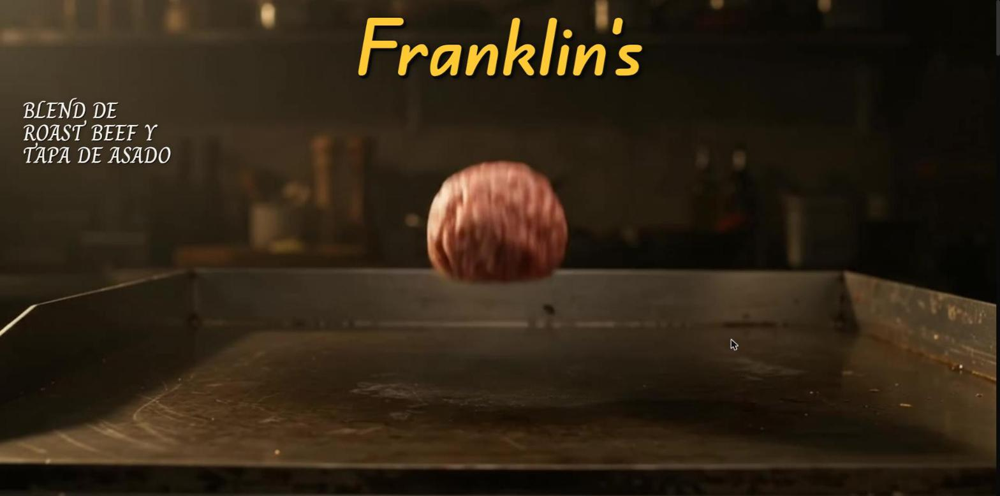
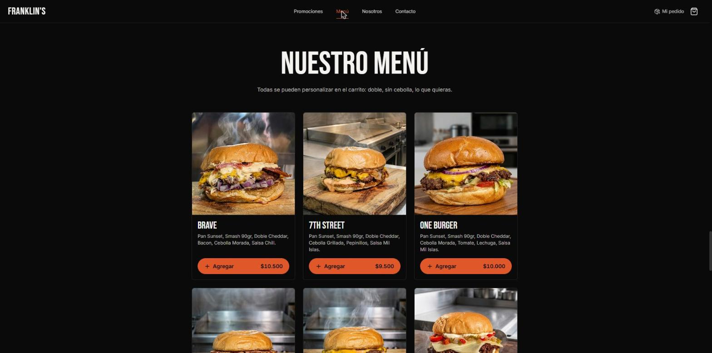

# Franklin's Burgers — Tienda de pedidos online (MVP)

**Demo:** [franklins-lemon.vercel.app](https://franklins-lemon.vercel.app/)

MVP desarrollado como propuesta comercial para una hamburguesería: una tienda donde el cliente arma su pedido y lo envía al local por WhatsApp, con un panel de administración para el negocio.

> El código es privado. Este repositorio documenta el proyecto.

## ✨ Funcionalidades

- **Inicio con video animado al hacer scroll**.
- **Menú y promociones** con precios.
- **Carrito** con productos personalizables (doble, sin cebolla, etc.).
- **Checkout** con entrega por delivery o retiro en el local, y pago en efectivo, por transferencia o con Mercado Pago.
- **Envío del pedido por WhatsApp**, ya armado para que el local lo confirme.
- **Panel de administración** para el negocio.

## 🛠️ Stack

React · Vite · Tailwind CSS · Supabase · Vercel
